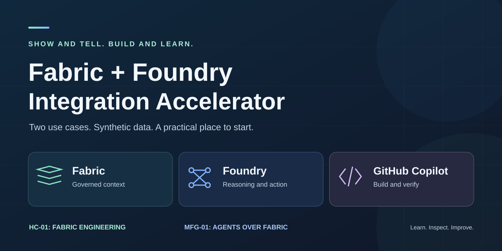

# Fabric Foundry Integration Accelerator



**Show and tell. Build and learn.**

Use this repo to learn how **Microsoft Fabric**, **Microsoft Foundry** and **GitHub Copilot**
work together. It is a reference implementation and a guided learning app—not a deployed
customer solution. Choose one workflow, build it with synthetic data, and verify the result.
You do not need an Azure account for the offline path.

**Why use it?** Improve repeatable Fabric data-engineering work with coding assistants,
then learn how governed data supports grounded agents. Understand each tool's responsibility
before connecting it to a live service.

**How to start:** follow [Quick start](#quick-start), open **Start here**, choose a **Use Case**,
and work through one checkpoint at a time. Use **Hands-on labs** for focused practice and
**Architecture** to inspect components and trace the flow.

**Development showcase, not production deployment.** Normal app startup is LIVE-first
HYBRID in your configured development environment, with disclosed LOCAL read fallback.
Browse the searchable use-case catalog, inspect a workshop's overview and prerequisites,
then select **Start workshop**. See [Microsoft tooling and workshop alignment](docs/operations/tooling-and-workshop-alignment.md)
for supported integrations, deliberate exclusions and the workshop references behind this flow.

| Fabric | Foundry | GitHub Copilot |
|---|---|---|
| Provides governed data and business context | Uses that context for reasoning, orchestration, evaluation and action | Helps engineers understand the repo, write code, add tests and inspect failures |

**Keep the roles clear:** MCP provides tool access. Skills provide procedures. Neither grants
authority. Identity, policy and human approval control live changes.

**Synthetic data only.** This is a learning repo and reference implementation, not a complete
production deployment. Preview features are optional.

**[Quick start](#quick-start)** · **[Use cases](#choose-a-use-case)** ·
**[Workshop](#build-and-learn-workshop)** · **[Repo map](#repository-map)**

## Choose a use case

| Guide | What you will build and learn | What is ready |
|---|---|---|
| [HC-01: Fabric engineering with GitHub Copilot](guides/hc-01-fabric-mcp-powerbi-medallion-lab/README.md) | Fabric MCP, Fabric Skills, Bronze/Silver/Gold notebooks and a planned Power BI handoff | Guide, reviewed notebooks and offline build. Live landing verified. Live completion is deferred. |
| [MFG-01: Foundry agents over Fabric](guides/mfg-01-foundry-fabric-sales-insights/README.md) | Sales insights, team briefs and reviewed quality proposals over synthetic manufacturing data | Offline briefs and quality checks. Connected evidence is dated and limited; answer and delivery gaps remain. |
| [DQ-01: Supporting quality exercise](guides/dq-01-synthetic-quality-investigation/README.md) | Exact quality checks and a governed notebook proposal | LOCAL checks and a SIMULATED change rehearsal. No cloud correction runs. |

HC-01 and MFG-01 are the two featured guides. Both stay in the repo.
Claude Code instructions and alternate prompts are available now; setup and execution come
later. Neither guide is fully live or production-certified.

## Get ready to share or present

| Audience | Start here |
|---|---|
| Customer or business team | [Customer field playbook](docs/field-playbooks/customer.html): value, tool roles and the two use cases |
| SE, developer or presenter | [SE/developer field playbook](docs/field-playbooks/se-developer.html): setup, build paths, checks and approval boundaries |
| New contributor | [Use-case onboarding](docs/operations/use-case-onboarding.md), [template](guides/_template/README.md) and [readiness checks](docs/operations/use-case-readiness.md) |

> **Portable delivery:** share either audience HTML file as an attachment, then open it
> directly in a browser. Each contains both playbooks and both complete demo handouts,
> with offline navigation, search and an interactive explorer for all architecture views.
> No second HTML download or local server is needed.
> Optional online source/code references are labeled and open in a new tab.

Presenter handouts: [Fabric engineering](demos/fabric-copilot-level-up/index.html) and
[Foundry agents](demos/foundry-fabric-agents-workshop/index.html). These are generated from
their YAML sources. They are separate presentation documents aligned with the app's use cases
and architecture—not screens or scripts inside the React learning workspace.
Use the [morning runbook](demos/MORNING-RUNBOOK.md) to prepare.

See [sharing scope](docs/operations/shareable-release.md) for what belongs in the public repo.

## Start here: choose your outcome

| I want to... | First step |
|---|---|
| Understand the architecture | Read the [repo map](docs/architecture/repository-map.md) and choose a [learning level](docs/education/learning-paths.md) |
| Try it without cloud access | Follow [Quick start](#quick-start), launch OFFLINE and open **Learn** or **Use Cases** |
| Build through a guide | Choose [HC-01](guides/hc-01-fabric-mcp-powerbi-medallion-lab/README.md) or [MFG-01](guides/mfg-01-foundry-fabric-sales-insights/README.md), then stop at each checkpoint |
| Add a use case | Follow [onboarding](docs/operations/use-case-onboarding.md) and reuse the existing registries and checks |
| Read or maintain the code | Follow the [code-reading path](docs/architecture/code-reading-path.md), then run the [release checks](docs/operations/release-validation.md) |

## Build-and-learn workshop

Follow **Start here → Use Cases → Hands-on labs → Architecture → Evidence** in the app.
Use `/use-cases` for the guides; existing `/guides` links still work.
Open **Explore** for concepts, patterns, data, the agent sandbox, recorded comparisons and
offline verification. These advanced tools do not compete with the primary build path.

**Do not confuse the connections:** coding assistants use **Fabric MCP tools** to reach
remote Fabric, even when the MCP process runs on the workstation. The **app's backend uses
Fabric REST**, a separate connection. **Offline synthetic data (DuckDB/Parquet)** is teaching
data and an eligible LOCAL read fallback, not a Fabric server. A fallback being available
does not mean it was used. See [connection boundaries](docs/operations/workshop-learning.md#three-connections-not-one).

Labs show one stage at a time with an outline, previous/next controls and browser-local
progress. Architecture diagrams are selectable SVGs, not screenshots: click a component
for its responsibilities and connections, drill into a neighbor, or step through a request
trace. Traces explain the design; they do not perform live operations.

- **Learn:** four journeys, 25 patterns and 21 lessons across Executive and L100-L400.
- **Build:** five labs, 130 knowledge checks and guide checkpoints.
- **Inspect:** source data, transformations, expected results, failure modes and recovery.
- **Test ideas:** compare a clear hypothesis against an independent baseline. Proposed
  experiments are not recorded findings or productivity claims.
- **Check evidence:** distinguish a local result, a simulation, a preview and a live operation.
  Missing labs and live checks stay visible.

Use the generated [GitHub Copilot](prompts/github-copilot/patterns.md) or
[Claude Code](prompts/claude-code/patterns.md) prompt packs.
The recorded comparison uses Claude and GPT models **inside GitHub Copilot CLI**.
It is not a GitHub Copilot versus Claude Code comparison.
Replay it at `/bakeoff` without a new cloud call.

### App preview

Captured on **2026-10-09**. These are **LOCAL screenshots** of synthetic workshop content.
The HYBRID status bar shows configuration, not proof of a live operation.

<details>
<summary>See the workshop and evidence screens</summary>


See the [current Learn page image](docs/architecture/screenshots/app-current-learn.png)
and the [documented screenshot gallery](docs/operations/workshop-learning.md#current-app-captures).

</details>

See [workshop learning and research](docs/operations/workshop-learning.md),
[reusable use-case onboarding](docs/operations/use-case-onboarding.md),
[the two integration paths](docs/architecture/integration-paths.md) and
[actual draw.io PNG exports](docs/architecture/diagrams/README.md).
Spec-driven delivery is optional. The repo skill and P25 explain when to use it.
Spec Kit is not installed or required for the default demo.

## Quick start

Prerequisites:

| Tool | Version | Notes |
|---|---|---|
| uv | 0.12.23 | Python package manager |
| Python | 3.14 | `uv python install 3.14` |
| Node.js | 24 LTS | Node 26 also tested |
| Git | any recent | |
| GNU Make | any recent | |

```bash
# Backend: always create and activate the virtual environment before installing
uv venv --python 3.14 .venv
source .venv/bin/activate
uv sync --frozen

# Frontend
cd frontend && npm ci && cd ..

# First useful success: no Azure setup required
make demo-offline
```

**Expected result:** `Release gate: PASSED` and zero cloud operations. Resolve errors before
connecting providers. Installation needs package-registry access; offline refers to execution.

### Choose one startup path

These are **alternatives, not commands to run in sequence**.

| Path | Start | Expected result / stop |
|---|---|---|
| **A. Workshop app (recommended)** | `make run API_ARGS=--offline` | Open http://localhost:5173; expect Workshop and OFFLINE status. Choose Learn or Use Cases at `/use-cases`. Ctrl+C stops this launch. |
| **B. Headless offline demo** | `make demo-offline` | Ten-act narrative ending in `Release gate: PASSED`; no browser needed |
| **C. Coding-client MCP** | Follow [MCP profiles](config/mcp/README.md) and the guide's tool setup | The coding client launches approved configured servers. `make run-mcp` starts only synthetic `ffia-local` stdio, not a website or the real Fabric MCP. Ctrl+C stops a manually launched server. |

The app command starts both API (:8000, API reference at http://localhost:8000/docs) and
frontend (:5173). Do not start `make run-api` before `make run`. Optional local exercises:
`make data` builds layers; `make recovery-demo` rehearses recovery (SIMULATED).

### Connect deliberately

For a fresh clone only, create private configuration without overwriting an existing file:

```bash
test -f .env || cp .env.example .env
```

Follow [environment configuration](docs/operations/environment-configuration.md), supply
private bindings and authenticate. Stop the offline app, then run `make run` for live-first
HYBRID. Inspect each result's provider, label and fallback; configuration is not LIVE proof.
Leave optional telemetry unconfigured for an entirely local session.

If ports are occupied, reuse the instance or stop only your owned launch. For remote VS Code,
forward the frontend port. See [startup troubleshooting](docs/operations/environment-configuration.md#startup-troubleshooting).

### Maintainer checks

`make validate` is the full local quality/release gate, **not a prerequisite to view the app**.
Run targeted checks first; see [release validation](docs/operations/release-validation.md).

Architecture diagrams (draw.io, Azure Architecture Center style, generated from YAML) are in
[`docs/architecture`](docs/architecture/README.md) and interactive in the app at `/architecture`.
Start with the [graphical repository map and guide screenshots](docs/architecture/repository-map.md)
and [environment configuration](docs/operations/environment-configuration.md).

See [control plane](docs/architecture/control-plane.md), [frontend](docs/architecture/frontend.md),
[resilience](docs/architecture/resilience.md), [demo continuity](docs/operations/demo-continuity.md)
and [learning paths](docs/education/learning-paths.md).

`make demo-live` and `make demo-hybrid` now run a bounded application Fabric read and one
synthetic Foundry question. They incur model usage, never create Fabric items, and do not
substitute for Guide 1's assigned MCP tools. A fallback cannot pass the live evaluation gate.
Run `make help` for every target.

## Repository map

| Path | Contents |
|---|---|
| `src/fabric_foundry_accelerator/` | Python package and `ffia` CLI |
| `tests/` | Unit, contract, offline, security, evaluation and opt-in live tests |
| `frontend/` | React + TypeScript + Vite educational application |
| `config/` | Customer overlays, environments, MCP profiles, policies, providers, privacy denylist |
| `data/synthetic/` | Synthetic data: raw → bronze → silver → gold → semantic → recovery |
| `education/`, `docs/`, `demos/`, `prompts/` | Learning content, documentation, demos, GitHub Copilot and Claude Code prompt packs |
| `guides/` | Customer-neutral Use-Case Guides |
| `notebooks/`, `powerbi/`, `fabric/workspace/` | Fabric notebooks, PBIP/TMDL, Fabric Git-format items |
| `docs/research/` | `sources.yaml` → `source-validation.md`, GA/preview matrix |
| `docs/decisions/` | Architecture decision records |

## Agent instructions

- [`AGENTS.md`](AGENTS.md) is the single source of truth for coding agents.
- [`CLAUDE.md`](CLAUDE.md) imports it for Claude Code.
- [`.github/copilot-instructions.md`](.github/copilot-instructions.md) summarizes it for GitHub
  Copilot.
- The root [`.mcp.json`](.mcp.json) is the portable MCP configuration shared by VS Code, GitHub Copilot
  CLI and Claude Code, rendered from the default profile `fabric-first` in
  [`config/mcp/profiles.yaml`](config/mcp/profiles.yaml). It starts the **real Fabric MCP server**
  (`@microsoft/fabric-mcp` 1.4.0, read-only, metadata only; LIVE once you `az login` to your demo
  tenant), Microsoft Learn, and the local educational server **`ffia-local` as the labeled
  fallback** when Fabric MCP is unavailable. Fabric Skills install with `ffia skills install`.
- [`config/harness/policy.yaml`](config/harness/policy.yaml) is one permission policy rendered
  for Claude Code (`.claude/settings.json`, with an enforced `ffia harness guard` hook), GitHub Copilot CLI
  (`--allow-tool`/`--deny-tool`) and VS Code (`chat.tools.terminal.autoApprove`). Opt-in Fabric MCP and Power BI Modeling
  MCP profiles are rendered per client with `ffia mcp render <profile> --client vscode|claude|copilot-cli`.

## Operating modes

`LIVE`, `HYBRID` and `OFFLINE`. Every result is labeled with one of `LIVE`, `HYBRID`, `LOCAL`,
`SIMULATED`, `MOCKED`, `PREVIEW` or `UNAVAILABLE`.

- Simulation is never presented as a real Fabric, Azure, Foundry, Power BI or MCP operation.
- An approved live write is never silently redirected to a local simulation.
- The offline demo is a release gate: `make validate` runs it.

## Privacy and safety

- **Synthetic data only.** No PHI, no PII, no credentials, no customer identity.
- `ffia privacy scan` checks a salted, hashed denylist of customer-identifying terms, GUIDs,
  secret patterns and e-mail addresses. It runs locally and in CI.
- Live cloud mutations are never performed automatically. Writes follow PLAN → VALIDATE →
  APPROVE → EXECUTE → VERIFY → AUDIT.
- Preview capabilities stay behind feature flags and are never required for the default demo.
  See [`docs/research/ga-preview-matrix.md`](docs/research/ga-preview-matrix.md).

## Readiness

- **Ready to build and learn:** HC-01 and MFG-01 guides, synthetic data and offline demos.
- **Still to complete:** HC-01 live end-to-end acceptance and the remaining MFG-01 connected
  answer checks.
- **Instructions only:** Claude Code setup and the cross-harness comparison.

Offline validation does not prove current cloud health or production readiness.
See the [sharing scope](docs/operations/shareable-release.md) and
[readiness gates](docs/operations/use-case-readiness.md).

## License

[MIT](LICENSE)
