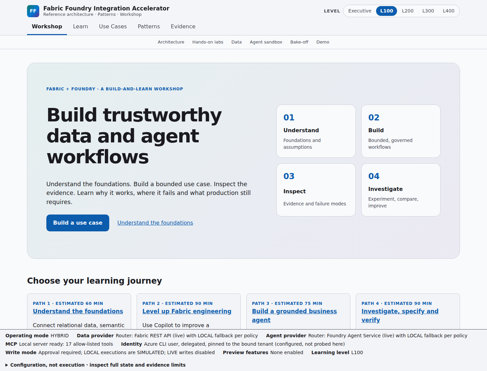
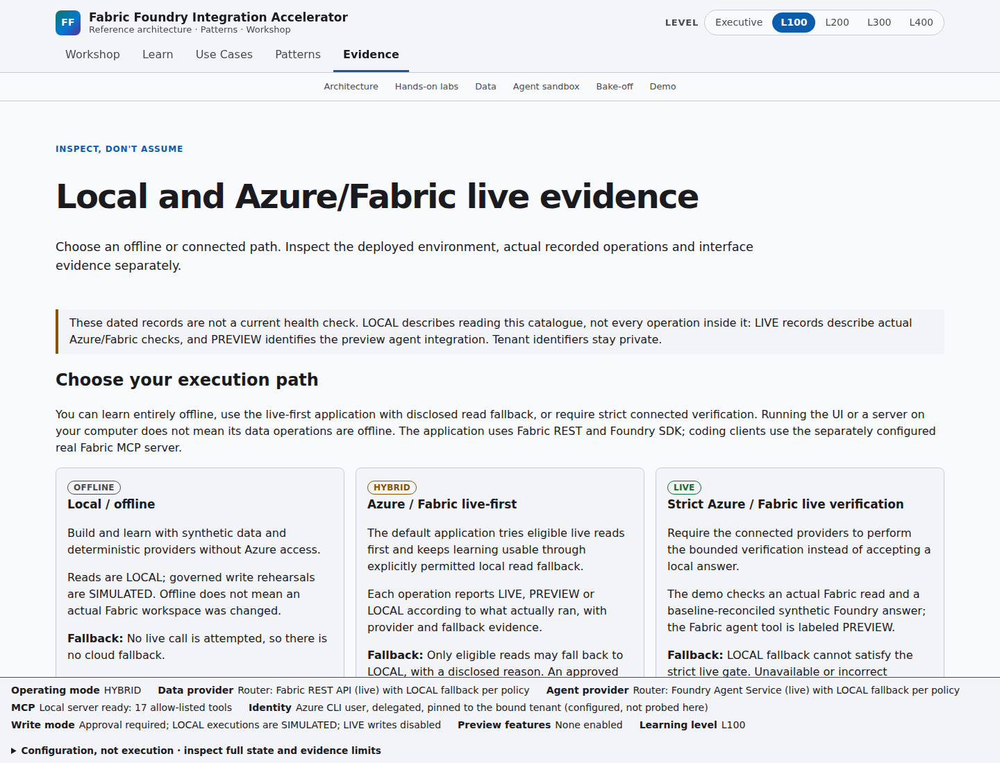

# Fabric Foundry Integration Accelerator

A reusable, customer-neutral **reference implementation, pattern catalog, workshop and demo
environment** for integrating **Microsoft Fabric** and **Microsoft Foundry**. It covers:

- **Fabric:** Fabric MCP, Fabric Skills, Fabric IQ, Fabric Data Agents
- **Agents and AI coding tools:** Microsoft Agent Framework, GitHub Copilot, Claude Code
- **Data engineering:** medallion architecture, Open Mirroring recovery
- **Governance and evidence:** human-in-the-loop actions, evaluation and observability

> **Fabric provides governed business context. Foundry turns that context into reasoning,
> orchestration, evaluation, and action. MCP standardizes access to capabilities. Enterprise
> identity and policy determine authority. Deterministic validation and human oversight
> constrain high-impact actions. Observability and evaluation provide evidence. Offline
> resilience ensures the architecture can always be demonstrated and taught.**

Learn it · See it · Build it · Run it · Break it · Recover it · Inspect it · Evaluate it ·
Customize it · Productionize it — in one project, with **synthetic data only**.

## Start here: choose your outcome

| I want to... | First three actions |
|---|---|
| Understand the architecture | Read the [repository map](docs/architecture/repository-map.md), choose a [learning depth](docs/education/learning-paths.md), then follow a workshop journey |
| Try the workshop without cloud access | Follow [Quick start](#quick-start), choose the OFFLINE app launch, then open **Learn** or **Use Cases** |
| Improve Fabric engineering with Copilot | Open [HC-01](guides/hc-01-fabric-mcp-powerbi-medallion-lab/README.md), check prerequisites, then stop at its first checkpoint |
| Build agents over Fabric context | Open [MFG-01](guides/mfg-01-foundry-fabric-sales-insights/README.md), explain ownership boundaries, then compare offline answers with the baseline |
| Add another use case | Define the outcome, follow [onboarding](docs/operations/use-case-onboarding.md), then validate the registry and teaching links |
| Read or maintain the code | Follow the [code-reading path](docs/architecture/code-reading-path.md), run targeted checks, then use the [release gate](docs/operations/release-validation.md) |

No Azure account is needed for offline learning. Normal interactive startup remains live-first
HYBRID; choose OFFLINE explicitly for your first cloud-free workshop.

Use-Case Guides under `guides/`: **HC-01** (Fabric MCP + Power BI medallion lab, healthcare,
synthetic) and **MFG-01** (Foundry + Fabric sales insights, manufacturing, synthetic).

Workshop talk tracks (presenter scripts with portal, VS Code, web app and offline paths, generated
from YAML with `ffia talktracks render`, also linked from the app's Demo page):

- **Guide 1:** [Leveling up Fabric data engineering with GitHub Copilot](demos/fabric-copilot-level-up/index.html)
- **Guide 2:** [Foundry + Fabric agent workshop](demos/foundry-fabric-agents-workshop/index.html)
  (manufacturing, synthetic; offline commands `ffia mfg brief`, `ffia mfg quality`,
  `ffia agents ask|eval|workflow`, and the app's Agent page)
- Morning setup: [demos/MORNING-RUNBOOK.md](demos/MORNING-RUNBOOK.md)

Both guides also have generated [Copilot](prompts/github-copilot/patterns.md) and
[Claude Code](prompts/claude-code/patterns.md) prompt packs. The recorded bake-off compares
Claude and GPT models **inside Copilot CLI**, not Copilot versus Claude Code.
Replay evidence offline at `/bakeoff`; no new cloud operation occurs during replay.

See [security and threat model](docs/security/README.md),
[release validation](docs/operations/release-validation.md) and
[observability evidence](infra/observability/README.md). The education completeness gate covers
all 30 questions across Executive and L100-L400. See the
[phase verification and current live evidence](docs/operations/phase-verification.md).
Capacity activation starts billing and remains an explicit human operation.

## Build-and-learn workshop

The app's primary navigation is **Workshop, Learn, Use Cases, Patterns and Evidence**.
Architecture, labs, data exploration, the agent sandbox and recorded bake-off remain available
as workshop tools. `/use-cases` is canonical; existing `/guides` deep links still work.

- **Breadth:** four outcome-led journeys and 25 patterns, all linked to five-level teaching.
- **Depth:** 21 lessons, Executive through L400, with 130 knowledge checks and five labs.
- **Practice:** what, why, when, when not, implementation, expected results and recovery.
- **Applied research:** fundamentals, conceptual evolution, falsifiable hypotheses, controlled
  experiments, independent baselines, metrics, sources and limitations. Experiments are proposed
  studies, not fabricated findings or productivity claims.
- **Use cases:** a visible business-to-build progression explains how Copilot, repository
  grounding, Fabric Skills and Fabric MCP improve engineering, and how Fabric context supports
  Foundry sales reasoning and reviewed proposals.
- **Evidence:** OFFLINE/HYBRID/LIVE options, existing Azure/Fabric resource checks, actual recorded
  operations and downloadable public verification records disclose their exact scope.
  Local interface images are separate from cloud-operation evidence.
  The coverage matrix exposes missing labs and recorded evidence; teaching is not live certification.

### App preview

Captured from the running app on **2026-10-09**. These are **LOCAL interface captures**
of synthetic workshop content. The HYBRID status bar shows configuration, not proof of a
new Fabric, Foundry or MCP operation.





See the [current Learn page image](docs/architecture/screenshots/app-current-learn.png)
and the [documented screenshot gallery](docs/operations/workshop-learning.md#current-app-captures).

See [workshop learning and research](docs/operations/workshop-learning.md),
[reusable use-case onboarding](docs/operations/use-case-onboarding.md),
[the two integration paths](docs/architecture/integration-paths.md) and
[actual draw.io PNG exports](docs/architecture/diagrams/README.md).
Spec-driven delivery is optional: the repository Skill and P25 explain when to use it;
upstream Spec Kit is not installed or required for the default demo.

## Quick start

Prerequisites:

| Tool | Version | Notes |
|---|---|---|
| uv | 0.12.23 | Python package manager |
| Python | 3.14 | `uv python install 3.14` |
| Node.js | 24 LTS | Node 26 also tested |
| Git | any recent | |
| GNU Make | any recent | |

```bash
# Backend: always create and activate the virtual environment before installing
uv venv --python 3.14 .venv
source .venv/bin/activate
uv sync --frozen

# Frontend
cd frontend && npm ci && cd ..

# First useful success: no Azure setup required
make demo-offline
```

**Expected result:** `Release gate: PASSED` and zero cloud operations. Resolve errors before
connecting providers. Installation needs package-registry access; offline refers to execution.

### Choose one startup path

These are **alternatives, not commands to run in sequence**.

| Path | Start | Expected result / stop |
|---|---|---|
| **A. Workshop app (recommended)** | `make run API_ARGS=--offline` | Open http://localhost:5173; expect Workshop and OFFLINE status. Choose Learn or Use Cases at `/use-cases`. Ctrl+C stops this launch. |
| **B. Headless offline demo** | `make demo-offline` | Ten-act narrative ending in `Release gate: PASSED`; no browser needed |
| **C. Coding-client MCP** | Follow [MCP profiles](config/mcp/README.md) and the guide's tool setup | The coding client launches approved configured servers. `make run-mcp` starts only synthetic `ffia-local` stdio, not a website or the real Fabric MCP. Ctrl+C stops a manually launched server. |

The app command starts both API (:8000, API reference at http://localhost:8000/docs) and
frontend (:5173). Do not start `make run-api` before `make run`. Optional local exercises:
`make data` builds layers; `make recovery-demo` rehearses recovery (SIMULATED).

### Connect deliberately

For a fresh clone only, create private configuration without overwriting an existing file:

```bash
test -f .env || cp .env.example .env
```

Follow [environment configuration](docs/operations/environment-configuration.md), supply
private bindings and authenticate. Stop the offline app, then run `make run` for live-first
HYBRID. Inspect each result's provider, label and fallback; configuration is not LIVE proof.
Leave optional telemetry unconfigured for an entirely local session.

If ports are occupied, reuse the instance or stop only your owned launch. For remote VS Code,
forward the frontend port. See [startup troubleshooting](docs/operations/environment-configuration.md#startup-troubleshooting).

### Maintainer checks

`make validate` is the full local quality/release gate, **not a prerequisite to view the app**.
Run targeted checks first; see [release validation](docs/operations/release-validation.md).

Architecture diagrams (draw.io, Azure Architecture Center style, generated from YAML) are in
[`docs/architecture`](docs/architecture/README.md) and interactive in the app at `/architecture`.
Start with the [graphical repository map and guide screenshots](docs/architecture/repository-map.md)
and [environment configuration](docs/operations/environment-configuration.md).

See [control plane](docs/architecture/control-plane.md), [frontend](docs/architecture/frontend.md),
[resilience](docs/architecture/resilience.md), [demo continuity](docs/operations/demo-continuity.md)
and [learning paths](docs/education/learning-paths.md).

`make demo-live` and `make demo-hybrid` now run a bounded application Fabric read and one
synthetic Foundry question. They incur model usage, never create Fabric items, and do not
substitute for Guide 1's assigned MCP tools. A fallback cannot pass the live evaluation gate.
Run `make help` for every target.

## Repository map

| Path | Contents |
|---|---|
| `src/fabric_foundry_accelerator/` | Python package and `ffia` CLI |
| `tests/` | Unit, contract, offline, security, evaluation and opt-in live tests |
| `frontend/` | React + TypeScript + Vite educational application |
| `config/` | Customer overlays, environments, MCP profiles, policies, providers, privacy denylist |
| `data/synthetic/` | Synthetic data: raw → bronze → silver → gold → semantic → recovery |
| `education/`, `docs/`, `demos/`, `prompts/` | Learning content, documentation, demos, Copilot and Claude Code prompt packs |
| `guides/` | Customer-neutral Use-Case Guides |
| `notebooks/`, `powerbi/`, `fabric/workspace/` | Fabric notebooks, PBIP/TMDL, Fabric Git-format items |
| `docs/research/` | `sources.yaml` → `source-validation.md`, GA/preview matrix |
| `docs/decisions/` | Architecture decision records |

## Agent instructions

- [`AGENTS.md`](AGENTS.md) is the single source of truth for coding agents.
- [`CLAUDE.md`](CLAUDE.md) imports it for Claude Code.
- [`.github/copilot-instructions.md`](.github/copilot-instructions.md) summarizes it for GitHub
  Copilot.
- The root [`.mcp.json`](.mcp.json) is the portable MCP configuration shared by VS Code, Copilot
  CLI and Claude Code, rendered from the default profile `fabric-first` in
  [`config/mcp/profiles.yaml`](config/mcp/profiles.yaml). It starts the **real Fabric MCP server**
  (`@microsoft/fabric-mcp` 1.4.0, read-only, metadata only; LIVE once you `az login` to your demo
  tenant), Microsoft Learn, and the local educational server **`ffia-local` as the labeled
  fallback** when Fabric MCP is unavailable. Fabric Skills install with `ffia skills install`.
- [`config/harness/policy.yaml`](config/harness/policy.yaml) is one permission policy rendered
  for Claude Code (`.claude/settings.json`, with an enforced `ffia harness guard` hook), Copilot CLI
  (`--allow-tool`/`--deny-tool`) and VS Code (`chat.tools.terminal.autoApprove`). Opt-in Fabric MCP and Power BI Modeling
  MCP profiles are rendered per client with `ffia mcp render <profile> --client vscode|claude|copilot-cli`.

## Operating modes

`LIVE`, `HYBRID` and `OFFLINE`. Every result is labeled with one of `LIVE`, `HYBRID`, `LOCAL`,
`SIMULATED`, `MOCKED`, `PREVIEW` or `UNAVAILABLE`.

- Simulation is never presented as a real Fabric, Azure, Foundry, Power BI or MCP operation.
- An approved live write is never silently redirected to a local simulation.
- The offline demo is a release gate: `make validate` runs it.

## Privacy and safety

- **Synthetic data only.** No PHI, no PII, no credentials, no customer identity.
- `ffia privacy scan` checks a salted, hashed denylist of customer-identifying terms, GUIDs,
  secret patterns and e-mail addresses. It runs locally and in CI.
- Live cloud mutations are never performed automatically. Writes follow PLAN → VALIDATE →
  APPROVE → EXECUTE → VERIFY → AUDIT.
- Preview capabilities stay behind feature flags and are never required for the default demo.
  See [`docs/research/ga-preview-matrix.md`](docs/research/ga-preview-matrix.md).

## Implementation history and verification scope

**Implemented, locally verified, live observed and production-ready are different claims.**
These phase labels describe history, not a learner sequence.

| Phase | Scope | Evidence state |
|---|---|---|
| 0-1 | Research, architecture and locked tooling | Implemented; locally verified; sources are dated and workflow execution is separate |
| 2-3 | Synthetic data and control plane | Locally verified; recovery/write rehearsals SIMULATED |
| 4 | Educational workshop | Locally verified; teaching coverage is not certification |
| 5 | Fabric integration | Application adapter and dated live reads; external Core/IQ MCP profiles/documentation; full HC-01 MCP/notebook/Power BI verification separate |
| 6 | Foundry integration | Dated live evaluation 5/5 and client telemetry ingestion observed; Fabric agent tool PREVIEW; server-side traces and scheduling/delivery remain unverified |
| 7 | Coding harnesses | Ten Copilot CLI model runs; Claude Code DOCUMENTED ONLY, not a cross-harness bake-off |
| 8 | Security/release/production | Repository tooling and local checks recorded; GitHub quality/CodeQL DEFERRED; production certification unverified |
| 9 | Final local validation | 2026-10-09: 616 backend tests, 99 frontend tests, 30/30 teaching coverage, zero-cloud offline demo; not current cloud health |

See [phase verification](docs/operations/phase-verification.md) for exact evidence and gaps.

## License

[MIT](LICENSE)
