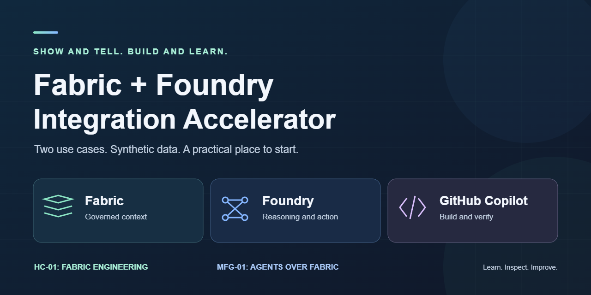

# Repo branding

Use this original image for the README, presentations or a repo preview.
It uses simple shapes and text, not Microsoft or GitHub product logos.
It does not imply endorsement or a completed live deployment.

| File | Use |
|---|---|
| [SVG banner](fabric-foundry-banner.svg) | Editable source and scalable presentation artwork |
| [PNG banner and social preview](fabric-foundry-social.png) | README, GitHub repository social preview and slide images |

Both images are 1280 x 640. The SVG has no scripts, external images, fonts or tracking.
README previews use the PNG for compatibility with renderers that cannot display SVG.
Edit the SVG source to change the artwork. Keep the wording and two use-case labels
consistent with the root README.

The PNG was rendered from the SVG in a local browser canvas and checked for clipping.
After changing the SVG, export and check the PNG again.
To use it on GitHub, open repository **Settings → General → Social preview** and upload
the PNG. This does not change the README banner or enable website hosting.

## About text

Copy this into the repo's About description:

> Build and learn Microsoft Fabric + Microsoft Foundry integration with GitHub Copilot.
> Includes Fabric MCP, Fabric Skills, Power BI, synthetic data, guided use cases, offline
> demos, and governance patterns. Claude Code instructions included.

Suggested topics: `microsoft-fabric`, `microsoft-foundry`, `github-copilot`,
`data-engineering`, `powerbi`, `mcp`, `agent-skills`, `medallion-architecture`,
`synthetic-data`, `offline-demo`.

Leave the website field blank until a hosted page is ready.
