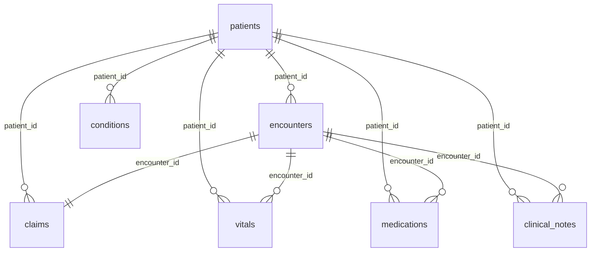

# Use-case authoring verification

Recorded **2026-10-13**. **LOCAL authoring gate: PASSED. Connected gate: PARTIAL.
Production gate: NOT CERTIFIED.**

This record covers revision `e90b09c` plus the DQ-01 authoring changes in the worktree.
It is not a tagged release or a GitHub workflow result. Review the implementation and this
record together before publishing a release.

## Read the checkpoint you need

- **HC-01:** source landing and profiling are verified. Bronze publication is tool-reported,
  not independently verified. Live end-to-end completion is deferred.
- **MFG-01/DQ-01:** the offline paths are shareable. Connected evidence is dated and limited;
  revenue reconciliation and final assistant answers remain unverified.
- **Claude Code:** instructions are available now. Setup and execution are deferred.

Read the dated checks below for exact scope. See the [resume tracker](resume-later.md) for
deferred work. Nothing in this record grants approval for a new operation.

## Authoring requirements and recorded results

| Requirement | Evidence | Scope |
|---|---|---|
| Extend without scenario-specific UI | DQ-01 registered in guide/workshop YAML; real API catalogue, story, all six steps and shared UI runner | LOCAL |
| Reuse rather than fork | Manufacturing profile/baseline, existing five-level lessons, manufacturing draw.io/PNG and presenter handout | LOCAL authored content |
| Reject broken authoring assets | Parameterized tests for instructions, baseline identity/JSON/path, diagram source/PNG, presenter source/handout, skills, tools, fallback and policy | LOCAL |
| Exact quality threshold | All nine categories match committed expected counts; `--check` exits nonzero for a scratch mismatch | LOCAL deterministic calculation |
| Authority stays separate | Real API plan, self-approval refusal, independent approval, SIMULATED execution, verification, duplicate-execution refusal and audit | SIMULATED notebook creation only |
| Prove another extension | An isolated fourth guide copied from the template is registered, validated and served without core changes | LOCAL regression |
| No cloud requirement | Network-blocked offline tests; isolated checkout without private dotenv or bindings | LOCAL |
| Shared UI usability | Six steps at 1440px and 390px; actual offline API rehearsal; no detected WCAG-tagged axe violations, overflow or browser errors | LOCAL interface evidence |

## Commands and results

```bash
source .venv/bin/activate
ffia education check --min-coverage 1.0
ffia mfg quality --check --json
pytest tests/offline/test_use_case_authoring.py --no-cov -q
```

**PASSED:** 21 lessons at five levels, 130 knowledge checks, 30/30 completeness; nine quality
categories reconciled; 20 offline authoring tests passed. These architecture-completeness
counts are not live-certification percentages.

```bash
FFIA_ENVIRONMENT=offline FFIA_FABRIC_LIVE=0 FFIA_FOUNDRY_LIVE=0 \
  FFIA_APPLICATIONINSIGHTS_CONNECTION_STRING='' make validate
```

**PASSED:**

- Backend: 638 passed, one opt-in live test skipped; 96.05% coverage.
- Frontend: 100 passed; 98.86% statements, 86.58% branches.
- Python/TypeScript strict types, lint/format, package/bundle builds.
- Data determinism, generated schemas/sources/diagrams, MCP, notebooks, skills, prompts,
  talk tracks, harness and recorded bake-off drift checks.
- LOCAL agent evaluation: 5/5; offline demo passed.
- Dependency audits: no known Python vulnerabilities; npm reported zero vulnerabilities.
- CycloneDX schemas/runtime pins passed: 163 Python and 345 frontend components.
- Privacy scan at that gate: 772 files, zero findings.

The session-only browser verifier checked 12 step/viewport combinations against the real
offline API and completed a SIMULATED rehearsal. No cloud tools were invoked by that test.

### Pre-commit refresh: 2026-10-13

`make validate` **PASSED** against the combined authoring, tooling and evidence changes:
639 backend tests passed, one opt-in live test skipped, 96.05% backend coverage; 100 frontend
tests passed, 98.86% statements and 86.58% branches. Lint, strict types, both builds, dependency
audits, SBOM validation, generated-artifact checks, LOCAL evaluation and offline demo passed.
The privacy gate checked 775 files with zero findings.

Review then corrected the workshop's stale trace-verification gap: server-side traces were
observed, but complete assistant answers and revenue reconciliation remain unverified.
`make fixtures` regenerated the API fixtures. `ffia education check --min-coverage 1.0` and
`pytest tests/contract/test_frontend_fixtures.py tests/offline/test_use_case_authoring.py tests/unit/test_education.py --no-cov`
**PASSED**, with 83 targeted tests. These checks do not execute or certify connected workloads.

### Isolated checkout rehearsal

Copied tracked HEAD plus the authoring changes into a temporary checkout. No private
dotenv or customer binding files were copied. The initial check confirmed missing local tools;
created and activated a new Python 3.14 virtual environment, then restored `uv.lock` using
`uv sync --frozen --offline`. Restored frontend dependencies with `npm ci --offline` after the
fresh typecheck demonstrated missing packages.

**PASSED:** education gate, exact quality baseline, 20 network-blocked authoring tests,
offline demo, frontend strict types, 28 targeted guide/workshop tests and production bundle.
The temporary checkout was cleaned up. This is an isolated snapshot rehearsal, not evidence
that a remote clone of uncommitted changes already contains the implementation.

## Explicit warnings

The existing Power BI Modeling MCP profile has no pinned tool catalogue. Education checks
disclose three HC-01 steps whose documented operation names require connected validation.
Their tool contracts were not certified offline. Validated Fabric allowlists and local
tool/skill references remain blocking checks; a warning grants no tool or write authority.

## Connected verification: sign-in corrected, execution gates open

An actual read-only call used **Microsoft Fabric / `fabric-mcp` / `core_search-catalog`**,
searching the synthetic manufacturing lakehouse name with a Lakehouse filter and page size five.
The server returned HTTP 200, but the returned metadata did not match the requested synthetic
scope. No returned tenant/workspace/item identifiers or unrelated resource names are retained
in public evidence.

This proves only that the tool returned a response. It does **not** establish the intended demo
tenant, an exact target match, quality calculations, notebook execution or publication.
No LOCAL fallback was used to convert that response into a connected-verification pass.
The operator chose to pause and confirm/correct MCP sign-in before more tenant inspection.

After the operator confirmed corrected sign-in, the scoped retry established:

- Azure CLI tenant/subscription matched the private bindings.
- Read-only Fabric readiness passed authentication, API access, active capacity and the
  bound dev workspace. Required tenant settings passed; optional GitHub sync warned and
  preview checks were skipped.
- Read-only Foundry readiness passed resource/project/deployment/data-plane metadata checks
  and checks for the existing synthetic agent and Fabric connection. No inference ran.
- Actual **Microsoft Fabric / `fabric-mcp` / `core_search-catalog`** returned exactly one
  expected synthetic manufacturing lakehouse; its workspace matched the private dev binding.
- Actual **Microsoft Fabric / `fabric-mcp` / `onelake_list-items`** succeeded within that
  workspace and returned the expected manufacturing lakehouse/data-agent items.

Identifiers remain private. These checks verify metadata access and target scope only,
not notebook outputs, agent answer quality, monitoring ingestion or publication.

The operator subsequently installed Fabric Data Engineering 1.26.0 and Power BI Authoring
1.0.0 in the Linux extension host. Actual MCP discovery succeeded for both servers.
Power BI read-only startup was independently checked. The extension-managed notebook MCP
catalogue has no publish/run tool; publication uses a separate VS Code extension tool and
execution uses the remote kernel. See [tooling setup](notebook-powerbi-tooling.md).
After explicit operator approval, **LOCAL / Power BI Authoring MCP / `accept_eula`** completed,
and `connection_operations` with `ListConnections` returned an empty connection array. A fresh
server process verified persistence without accepting again. No model was connected.

Actual **Microsoft Fabric / extension-managed `fabric-notebook-mcp` / `list_artifacts`**
also succeeded for the expected synthetic lakehouse within the privately bound dev workspace.
Independent response comparison verified the exact workspace binding, name/type and single
result. This extends LIVE metadata evidence, not notebook/model execution evidence.
Native `fabricPublishNotebook` was unavailable in the earlier SDK chat's exposed inventory.
The operator reported enabling tools and reconnecting; a subsequent discovery retry still
did not expose the native publication/workspace tools. This is an unresolved client-exposure
boundary, not an extension installation failure. Repeating reloads is not additional evidence.
On the subsequent resumed session the native tools became exposed. `fabricWorkspaceInfo`
first reported a mismatched personal workspace; after the operator switched workspaces, the
next call matched the private dev binding exactly. Actual `fabricListNotebook` returned no
entries, and an independent workspace-scoped `fabric-notebook-mcp` `list_artifacts` call
confirmed zero Notebook items. No publication tool was invoked.
The reviewed HC-01 reference notebooks also passed `ffia notebooks check` (LOCAL).
The operator chose to complete HC-01 and continue MFG-01/DQ-01. Keep HC-01 in a separate
dedicated lab workspace. Retain the existing dev workspace for manufacturing.
HC-01 step 03 explicitly assigns workspace creation to the
operator in the Fabric portal; no automatic workspace creation or alternate transport was used.
An isolated HC-01 export completed locally, and `sha256sum -c SHA256SUMS` passed for all seven
synthetic CSVs. The export is source-preparation evidence, not OneLake upload evidence.
The operator then requested local HC-01 preparation while continuing MFG-01/DQ-01. The
isolated lab now includes all seven exported CSVs, three reviewed Fabric Git-format notebook
definitions, scoped instructions, the expected baseline, safe Power BI startup settings and
authoritative HC-01 MCP renderings for VS Code and Claude. Independent comparison verified
the copied definitions, baseline and both renderings. No server was started from those configs.
The LOCAL HC build matched the baseline: 24 tables and 58/58 checks passed. LOCAL MFG quality
reconciled all nine categories, and the Enclosures brief reproduced the independent baseline.
Extension activation generated local dependency stubs and private workspace/VFS caches.
Root-scoped ignore rules now isolate them without deleting state or excluding public source
files. The subsequent privacy scan passed: 776 files, zero findings.

## HC-01 dedicated workspace verification: 2026-10-13

After the operator reported manual creation and VS Code selection of `ffia-hc01-lab`,
actual **LIVE / Microsoft Fabric / Fabric Data Engineering extension / `fabricWorkspaceInfo`**
selected that workspace. **LIVE / Microsoft Fabric / `fabric-mcp` / `core_search-catalog`**
returned an exact workspace match. The catalogue also returned unrelated manufacturing entries;
only the exact HC workspace name and ID match was used as target evidence.
An exact-ID **`fabric-mcp` / `onelake_list-items`** read returned an empty item list and no
continuation. The assistant did not perform workspace creation.

A separate **LIVE / repository SDK readiness path / `ffia fabric readiness --json`** check
used process-only HC workspace overrides and the existing private tenant pin. It passed
sign-in, capacity, exact HC workspace assignment and required tenant-setting checks.
The GitHub workspace-sync setting remains a warning; preview settings were skipped.
This GET-only readiness check is not an MCP invocation or write authorization.
Saved manufacturing bindings and the default read-only configuration were not changed.

**LOCAL / `ffia-local` / `generate_fabric_change_plan`**, followed by
**`validate_change_plan`**, proposed only an empty `healthcare_lakehouse` in alias `hc01-lab`,
destination LIVE. Both returned **BLOCKED**: the alias is undeclared in the active overlay
and live mutation is disabled. The existing MCP session also reports no configured live writer.
This blocked plan is not approval or evidence of lakehouse creation. Discovery exposed
`core_create-item` only on the separately configured `Fabric-MCP` server, not the selected
read-only `fabric-mcp` server; it was not invoked or silently substituted.
At that checkpoint, the HC authoring context still needed to match the exact private binding
before a new allowed plan and operation-specific human approval. No HC lakehouse, upload,
publication, run, model or report operation had been performed.

The operator subsequently approved **configuration and planning only** in the isolated HC lab.
Its private binding contains only `hc01-lab`, and its derived overlay permits only
`create_lakehouse`. Hash comparison verified unchanged root environment files, MCP configuration
and manufacturing bindings. The local MCP server initialized and its plan/validation tools
recognized the HC alias, but correctly retained the unconditional LIVE-mutation block imposed
by `ffia serve mcp`. That safeguard was not modified or bypassed.

The existing API control plane was then exercised locally through its in-process HTTP client:
an HC-only LIVE-destination lakehouse plan was proposed and revalidated, with human approval
still required. Upload and manufacturing-alias plans were rejected. No API approval or
execution was performed; its live writer remains disabled. This is **LOCAL API planning**,
not a LIVE API execution or an MCP planning success.

The isolated, reviewed `hc01-lab` Fabric MCP server also initialized through the MCP SDK.
Its actual catalogue matched all seven configured tools, including `core_create-item`.
An actual **LIVE / configured `fabric-mcp` / `onelake_list-items`** call independently
matched the private HC workspace ID and empty inventory. No write tool was invoked.
The verification processes were stopped. Private plan, audit, catalogue and scoped-read
records were retained. The next step required separate approval for client-mediated Fabric MCP
lakehouse creation. That operation was completed below. It did not substitute for the disabled
API live writer.

## HC-01 lakehouse creation and verification: 2026-10-13

The operator separately approved **one** empty `healthcare_lakehouse` creation in the verified
HC workspace through the isolated MCP context. The requester and human approver were distinct.
The client-side approval record is destination-bound and uses the repository's approval-window
rule; it is not an API approval or execution claim.

After another exact-target empty-inventory check, **LIVE / Microsoft Fabric / isolated
`fabric-mcp` via MCP SDK / `core_create-item`** was invoked once and returned status 200.
Pre-flight client errors occurred before any create call and were corrected; the write itself
was not retried. The saved creation response contains the expected workspace, name, type and
new lakehouse ID.

Independent **LIVE / `fabric-notebook-mcp` / `list_artifacts`** returned exactly one matching
Lakehouse. Its ID matched the create response. A separate read-only **`fabric-mcp` /
`onelake_list-items`** confirmed the same persisted item in the HC workspace.
**`onelake_list-files`** found zero entries in `Files`; **`onelake_list-tables`** with namespace
`dbo` found zero tables and no continuation. Metadata reports `schemaEnabled=false` and
successful managed SQL endpoint provisioning. The successful `dbo` table-API listing does not
change that schema-enabled flag.

Private request/approval, receipt, response, verification and correlated audit records were
retained. Saved root/manufacturing configuration remained unchanged. This certifies **HC-01
step 04 only**: one empty lakehouse. No files were uploaded, notebooks published or run, semantic
models created, reports published, capacity changed or new agent inference attempted.
Rollback remains a separate approval to delete the empty, unused lakehouse.

## HC-01 source-landing preparation: 2026-10-13

All seven exported synthetic CSV hashes were rechecked against `SHA256SUMS`; parsed source
counts matched the seven expected counts. The files total 1,068,733 bytes.
The actual upload-tool catalogue confirms `local-file-path` and boolean `overwrite` controls.
A separate LOCAL upload-planning context permits only `upload_files` against `hc01-lab`;
lakehouse creation and manufacturing-alias plans were rejected. Existing root and earlier HC
configuration remained unchanged.

**LIVE attempt / chat read-only `fabric-mcp` / `onelake_list-files`** for `Files/raw` returned
404 with "the specified path does not exist." The parent `Files` read returned 200 and an empty
list. The lakehouse's exact ID/name/type was independently reconfirmed. Uploads were stopped
at the missing-directory prerequisite, not attempted or redirected to simulation.

The operator approved **only** creating the empty `Files/raw` directory. However, the isolated
authoring MCP SDK client's pre-flight `Files` read returned a tool error before any directory
write. Bounded read-only diagnosis through that same configured server recovered HTTP 404
`HttpRequestException`; omitting optional recursion did not resolve it. The difference between client contexts remains unresolved. No directory-creation receipt exists and
`onelake_create-directory` has not been invoked. No uploads or readback have occurred.

The next step is to resolve that context or explicitly approve a different configured
MCP server for the same bounded operation, with fresh exact-target preconditions. No REST/CLI
substitution or mutation retry is authorized. Content-hash verification after future uploads
requires separately approved, exact-file MCP readback; the current HC profile does not expose
`onelake_download-file`. Equal sizes alone will not be reported as content integrity.

### Approved alternate-server check: 2026-10-13

The operator explicitly approved changing to the separately configured `Fabric-MCP` server
for the directory-only operation, subject to fresh target and folder checks. Through that
server, `onelake_list-items` returned HTTP 404 `WorkspaceNotFound` (`isRetriable: false`), and
`onelake_list-files` for the parent `Files` returned HTTP 404. No write was attempted.

A fresh diagnostic `onelake_list-items` through the chat read-only `fabric-mcp` server also
returned `WorkspaceNotFound`; its earlier successful inventory is therefore historical,
not a current precondition. Independently, the Fabric Data Engineering extension still
selected the exact HC workspace, and `fabric-notebook-mcp` / `list_artifacts` returned exactly
one matching lakehouse with the previously verified ID. This is metadata evidence, not a
substitute for the failed write-context gate or evidence of a newly created directory.

**UNAVAILABLE at that checkpoint / source landing:** workspace access in the affected Fabric MCP contexts needed
verification and repair. The root cause is not established. No directory invocation, CSV
upload, readback, resource recreation or REST/CLI substitution occurred. The approval change
and bounded diagnostics are recorded privately. After reconnection, revalidate the exact
target and duplicates, and renew approval explicitly if expired before any directory write.

### Recovered access and verified landing: 2026-10-13

Fresh read-only checks through both `fabric-mcp` and `Fabric-MCP` returned status 200 for
the exact HC workspace and lakehouse; the parent `Files` directory was empty.
Independent `fabric-notebook-mcp` metadata still matched the original lakehouse.
Access was observed to work again; no credential repair or root cause is claimed.
All seven source hashes were revalidated. The expired directory approval was explicitly
renewed, and **LIVE / Microsoft Fabric / `Fabric-MCP` / `onelake_create-directory`** was
invoked once for `Files/raw`. It returned status 200. Independent read-only
`fabric-mcp` / `onelake_list-files` confirmed the `raw` directory and its empty contents.

The isolated LOCAL API control plane then proposed and revalidated a bounded LIVE-destination
`upload_files` plan. A separate explicit human approval covered exactly seven uploads with
overwrite disabled and seven exact-file readbacks through the separately configured
`Fabric-MCP` server. It did not extend the root read-only profile or authorize other data reads.
Each **`onelake_upload-file`** call returned status 201; no upload was retried.
Independent **`fabric-mcp` / `onelake_list-files`** returned exactly the seven expected CSVs
under `Files/raw`, totaling 1,068,733 bytes. Each **`Fabric-MCP` / `onelake_download-file`**
returned status 200 and saved the approved file to the private session readback folder.

Local comparison of those actual remote readbacks with the pre-upload manifest passed
SHA-256, byte-size and CSV-aware row-count checks for every file:

| Synthetic source | Parsed rows | Content verification |
|---|---:|---|
| patients.csv | 200 | SHA-256 matched |
| encounters.csv | 1,025 | SHA-256 matched |
| conditions.csv | 428 | SHA-256 matched |
| claims.csv | 1,025 | SHA-256 matched |
| vitals.csv | 4,299 | SHA-256 matched |
| medications.csv | 643 | SHA-256 matched |
| clinical_notes.csv | 150 | SHA-256 matched |

This verifies **HC-01 step 05 LIVE source landing and content integrity**, not merely transfer
length. Private approvals, manifest, readbacks, verification receipt and correlated audit
records were retained. No source correction, table creation, notebook publication/run, model,
report or capacity change was performed. Rollback deletion still requires separate approval.
The next guide checkpoint is step 06: local source profiling before notebook authoring.

### Fabric portal display confirmation: 2026-10-13

The operator's portal screenshot showed the SQL analytics endpoint with no user tables,
not the lakehouse Files explorer. A fresh **LIVE / Microsoft Fabric / read-only `fabric-mcp`
/ `onelake_list-files`** check still returned all seven uploaded CSVs under `Files/raw`.
After selecting **Go to lake mode** and expanding **Files → raw**, the operator explicitly
confirmed that all seven files were visible. This is operator-reported portal confirmation,
not an assistant browser screenshot or a notebook-execution claim. The assistant browser
tool was unavailable because its Chrome executable was missing.

No data or resource repair was needed. Raw CSV landing does not create Delta tables, and
the empty SQL user-table view is expected until separately approved table-building work runs.
No notebook, table creation, reload operation or resource recreation was performed to resolve
this display question.

## HC-01 source profile: 2026-10-13

**LOCAL / Python CSV-aware parser**, over the same seven source files already reconciled to
LIVE Fabric readbacks, completed step 06 without cloud calls or source edits. Parsed row
counts and five diagnostic counts matched the independent committed baseline. The private
structured profile records every column, candidate key, blank/duplicate key count and
patient/encounter reference check. Column contracts are defined in the
[synthetic generator](../../src/fabric_foundry_accelerator/synthetic/generator.py).

| Source | Rows | Validated candidate key | Blank keys | Excess duplicate keys |
|---|---:|---|---:|---:|
| patients | 200 | patient_id | 0 | 0 |
| encounters | 1,025 | encounter_id | 0 | 0 |
| conditions | 428 | condition_id | 0 | 0 |
| claims | 1,025 | claim_id | 0 | 0 |
| vitals | 4,299 | vital_id | 0 | 0 |
| medications | 643 | medication_id | 0 | 0 |
| clinical_notes | 150 | note_id | 0 | 0 |

All nonblank patient and encounter references resolved to their parent keys; no
patient/encounter ownership mismatch was found. These are observed synthetic-data
relationships, not production constraints inferred from names alone.
Every encounter has exactly one claim in this dataset.



- All 428 condition `encounter_id` values are blank. Conditions form a patient-level
  problem list; an encounter relationship must not be fabricated.
- All 1,025 discharge dates were nonblank and parsed as ISO dates. None preceded admission.
- Four recorded length-of-stay values differ from the date-derived durations, matching the
  intentional baseline. Bronze must preserve them; later cleaning needs explicit rules.
- Exactly 56 notes contain the literal two-character sequence `\n`; none contains an actual
  newline. Do not silently convert or discard that source text during ingestion.

Source profiling completed before the step 07 notebook drafting checkpoint below. No claim
is made that tables, a Power BI model/report or the full connected workshop are complete.

## HC-01 native Bronze scaffold and LOCAL draft: 2026-10-13

Actual **LIVE / Microsoft Fabric / Fabric Data Engineering extension /
`fabricWorkspaceInfo` and `fabricListNotebook`** confirmed the selected HC target and no
existing notebooks. Independent **LIVE / `fabric-notebook-mcp` / `list_artifacts`** also
returned zero notebooks; `get_lakehouse_detail` matched the private lakehouse and reported
successful SQL endpoint provisioning.

The operator separately approved one empty `MCP_01_Bronze` scaffold through the native
`fabricCreateNotebook` tool, with no publication or execution authorization. One invocation
reported successful creation and issued the VS Code open-folder notification. An independent
`list_artifacts` read returned exactly one Notebook with the expected name and description;
its identity matched the native download's artifact path. This certifies scaffold creation,
not publication of the reviewed code.

The downloaded copy was then populated **LOCAL**, using the existing notebook generator:

- Four cells: explanation, parameters/counts, validation/write helpers, ingestion driver.
- Cell sources match the reviewed `MCP_01_Bronze.Notebook` reference. The reference intentionally
  reads CSV columns as strings rather than enabling schema inference, preserving raw values
  before Silver applies explicit types.
- Seven relative `Files/raw` reads use headers, multiline parsing, double-quote escaping and
  fail-fast CSV parsing. Source counts are checked before each table write; persisted Delta
  tables are read back. Source values and grains are retained with lineage columns.
- Private default-lakehouse dependency and PySpark metadata were added only to the ignored
  native download. No real identifiers were added to public notebook definitions.
- Official nbformat-v4 schema validation, Python syntax checks, exact-source comparison,
  source-line-ending checks and local file readback passed using existing dependencies.
- VS Code `getNotebookSummary` returned four cells and confirmed none had executed.

The native download is covered by the repository's private workspace-cache ignore rule.
Client-mediated approval, creation, independent verification and LOCAL drafting audit records
are retained privately; these are not API approval/execution records.

**Checkpoint boundary:** Bronze drafting is complete. Publication requires a separate plan
bound to the exact local bytes and existing notebook identity, then explicit approval through
the native extension. Publication must stop at the tool's checkpoint; its result, persisted
content and binding still require verification before a separately approved remote runtime
run. No Bronze Delta output, Silver/Gold execution, semantic model or report is certified here.

### Native Bronze publication checkpoint

After exact-byte publication planning, a fresh native workspace/item check and separate
operator approval, **LIVE / Microsoft Fabric / Fabric Data Engineering extension /
`fabricPublishNotebook`** was invoked once for `MCP_01_Bronze`. The tool reported successful
publication. The required native publication checkpoint stopped further automatic actions.
This is a tool-reported outcome, not independent verification of persisted code or binding.
Publication approval and the planned scope were retained privately before invocation;
the correlated result receipt and independent verification still need completion.

The operator subsequently deferred HC-01 live end-to-end completion and Claude Code
setup/execution to a later session. Guides, reference notebooks, offline paths and Claude
instructions remain available and shareable. See the [resume tracker](resume-later.md).

## Resume boundary

1. Native notebook tools are exposed; the latest selected HC workspace matches the independent
   catalogue and verified lakehouse/source inventory. Use the isolated authoring context and exact
   private binding for HC planning. Confirm the exact target each publication plan covers; the
   reviewed HC-01 notebooks consume seven healthcare CSVs, not the manufacturing dataset.
   Restart Power BI read-only without automatic EULA acceptance;
   this operator has explicitly authorized acceptance, which was executed and verified.
   Root app bindings do not configure external servers.
2. Confirm the extension's sign-in, selected workspace and remote Spark kernel privately.
   HC-01 expects a dedicated lab workspace; an existing populated manufacturing workspace
   is not automatically its approved target.
3. Refresh capacity/readiness before capacity-dependent work. Capacity was active at the
   resumed check; actual billing/cost totals have not been queried.
4. Plan exact-target mutations, check duplicates, obtain separate human approval, execute only
   the approved operations, independently verify outputs and retain audit/rollback evidence.
5. Complete unresolved agent answer checks; server-side traces are now observed as described
   below. Scheduling/delivery still needs separate use-case-specific approval and verification.
6. Complete applicable production controls and actual release checks before certification.

The assistant's HC cloud mutations are limited to the approved lakehouse, raw directory,
seven synthetic source uploads, one native Bronze notebook scaffold and the separately
approved tool-reported Bronze publication above.
No data correction, capacity change, notebook run, schedule, GitHub
workflow dispatch or Claude Code bake-off was performed. Capacity/readiness was refreshed;
billing and actual cost totals were not queried.
Checkpoint `85e320a` was committed and pushed, but GitHub workflow verification remains
deferred. Full connected and production gates remain open.

## MFG-01/DQ-01: approved invocation and monitoring checks

Actual **Microsoft Foundry / Azure MCP / `agent_get`** inspected only the existing
`sales-insights-agent`: prompt agent, active version 3, expected Fabric connection. Private
binding comparison confirmed the connection. The sample agent-creation script was not run.

The operator explicitly approved two synthetic **`agent_invoke`** calls against version 3:
September/August Enclosures revenue and growth, then excess duplicate order-line count.
Both MCP calls returned HTTP 504. Neither was retried; no new agent version was created.
The operator also confirmed the dev Application Insights target and bounded trace queries.

Actual **Azure Monitor / Azure MCP / `monitor_resource_log_query`** observed recent
server-side spans for both questions. Exact user-message comparison correlated the revenue
trace; the duplicate trace showed the exact approved question. Fabric tool spans are present.
Span-level success flags do not prove a numeric answer or baseline reconciliation.
The first monitoring attempt cancelled immediately at a client timeout of zero seconds;
an explicit 60-second timeout allowed the read-only query to succeed.

The revenue trace contains a Fabric response reporting input-length rejection rather than
numeric results. It also shows a shorter follow-up query. This is observed tool-response
content, not independent proof of the downstream SQL error or its root cause.

With separate explicit approval, **Microsoft Foundry / Python SDK / `responses.retrieve`**
read only the two existing response IDs recovered from traces. No `responses.create` call
was made. Revenue retrieval returned HTTP 404. Duplicate retrieval returned a top-level
completed response with a completed Fabric preview call and its result document:

| Check | Expected | Observed | Result and boundary |
|---|---:|---:|---|
| Excess duplicate order-line records | 12 | 12 | PREVIEW Fabric tool result matches independent baseline |
| September/August Enclosures revenue and growth | Independent LOCAL brief | Not verified | MCP timed out; existing revenue response was not retrieved |
| All nine quality categories | Independent LOCAL quality baseline | Nine LOCAL categories matched | LOCAL only; not a nine-category live-agent pass |

The duplicate result defines the key as `(order_id, line_number)` and excess duplicates as
the sum of `group_count - 1`. Its source workspace independently matched the private dev
binding. The response also describes 12 duplicate keys and 24 rows in duplicate groups;
these are distinct metrics, not additive counts.
The Fabric output item still reports `in_progress`, and no final assistant message was
recovered. Therefore the result certifies the recovered tool payload's baseline match,
not a fully verified end-to-end assistant answer. Raw IDs, source URLs and results remain private.

Remaining work is deferred:

1. Independently verify the tool-reported HC Bronze publication and binding.
2. Separately plan and approve run/model/report operations and the Silver/Gold sequence.
3. Diagnose the revenue timeout/tool limit without duplicate inference.
4. Verify final assistant answers.

Production controls, schedule/delivery, actual billing and release checks remain uncertified.

## Interface capture


Synthetic LOCAL interface capture, not live Fabric/Foundry evidence. The shared manufacturing
architecture includes connected branches that remain outside DQ-01's offline acceptance scope.
