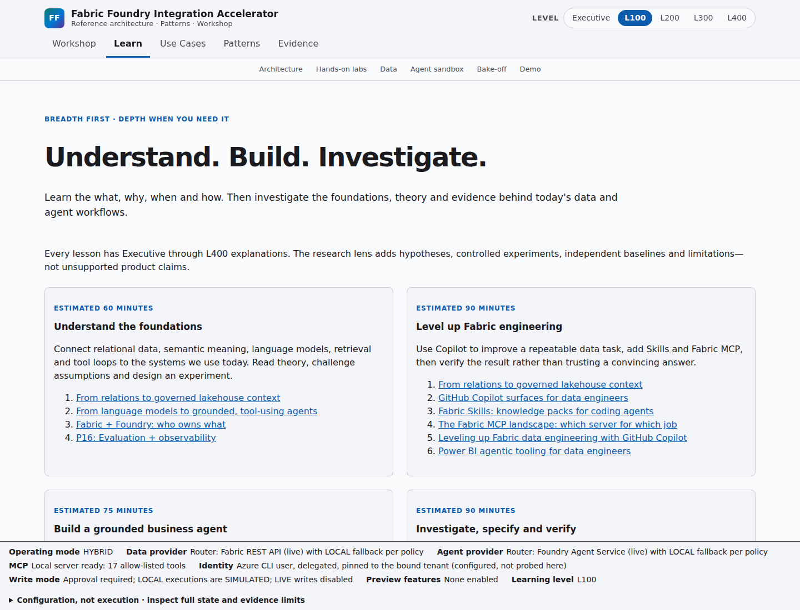
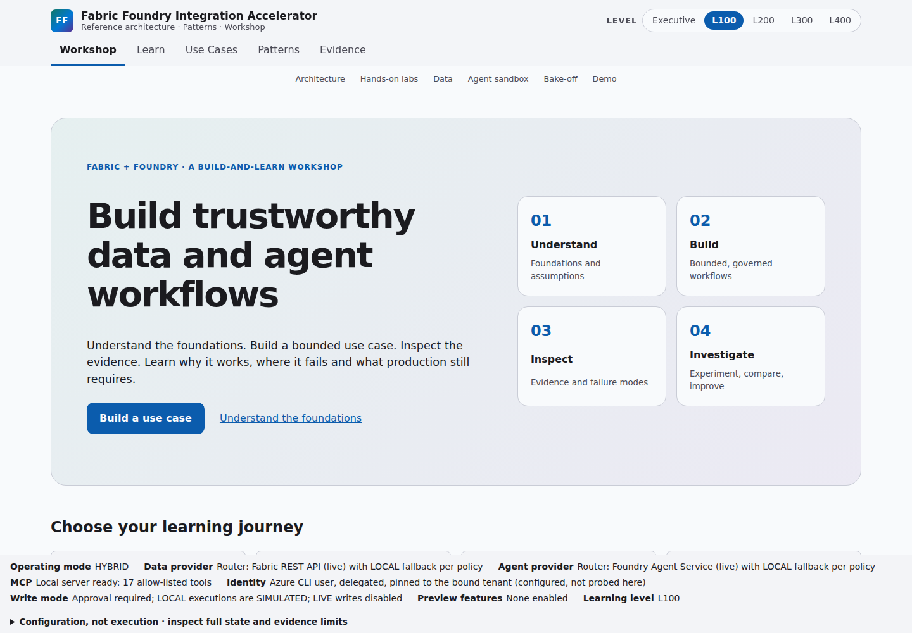
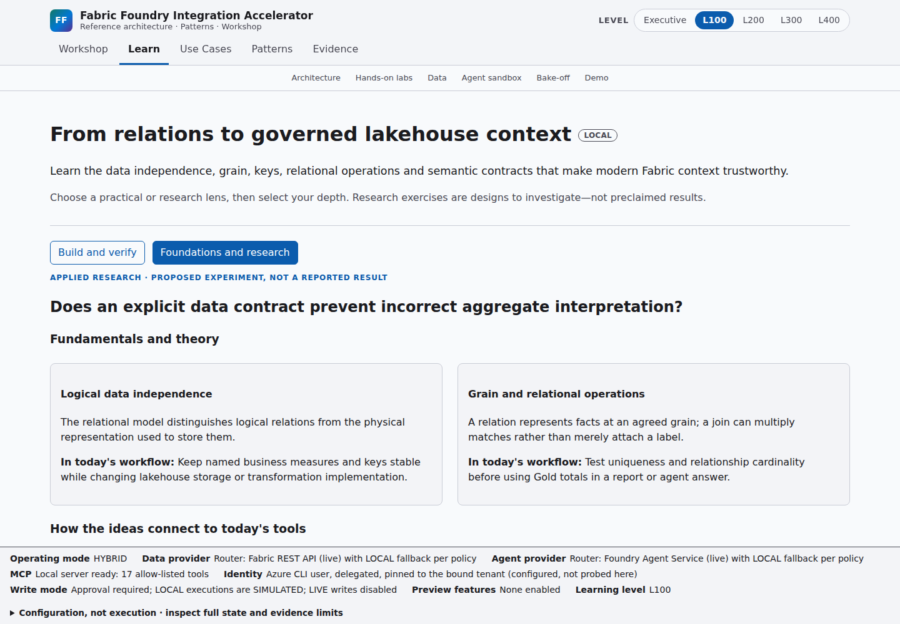
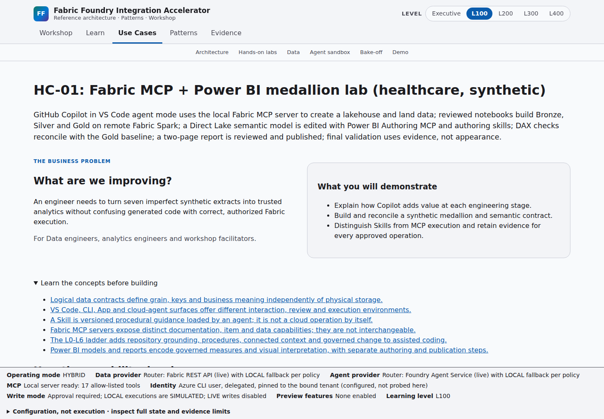
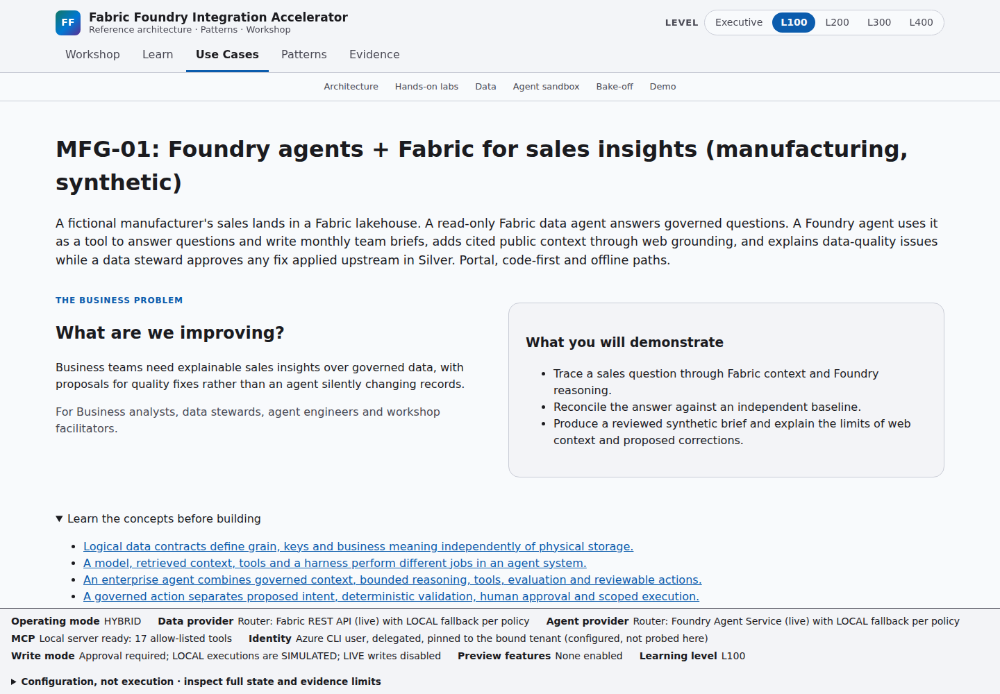
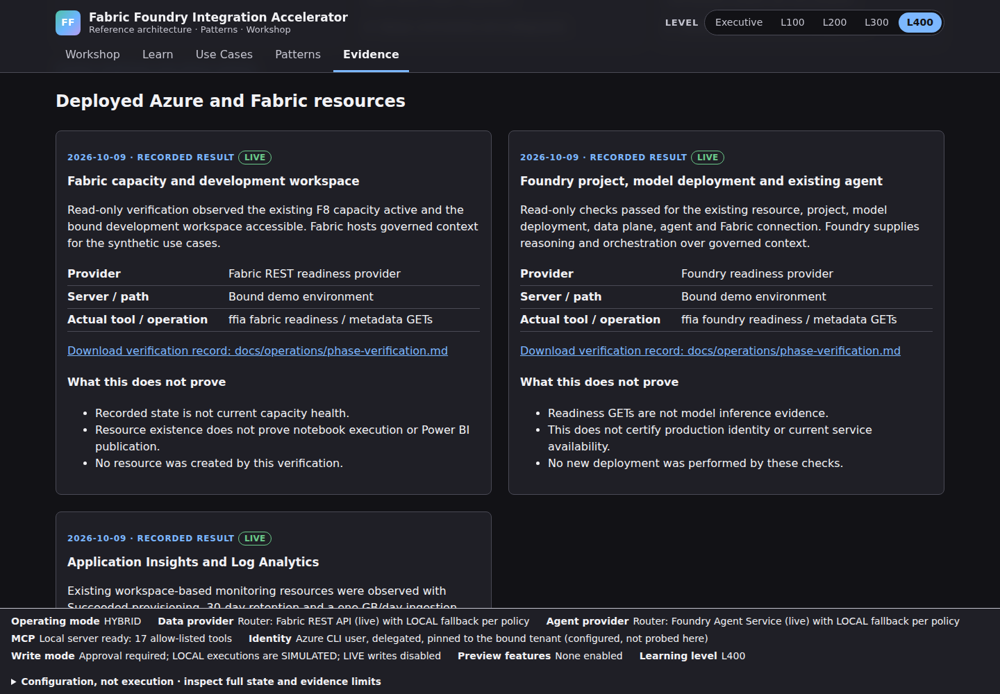
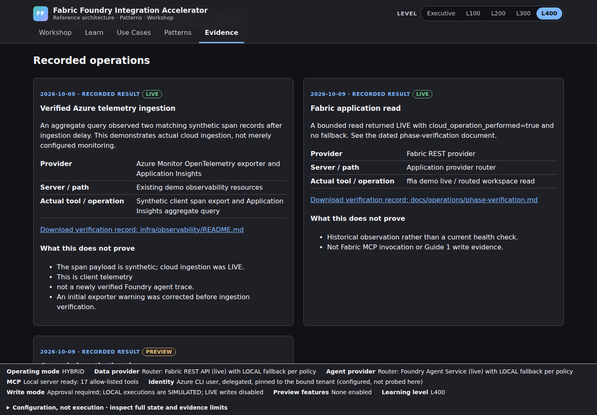

# Workshop learning and applied research

## A task-first learning workspace

Start with **Start here** to understand what the project is, why to use it and how to begin.
Choose **Use Cases** for an end-to-end workflow or **Hands-on labs** for a focused exercise.
The primary navigation keeps **Architecture** and **Evidence** close to the work; **Explore**
holds the concept library, patterns, data, agent sandbox, comparisons and offline verification.

The home page connects **Discover → Understand → Build → Verify**. The use-case catalog
supports search across titles, descriptions and tools, plus industry and tool/service filters; query parameters
preserve these choices in shared links. Cards come from registered guides, not fixed scenario
branches.

Each workshop has a separate **overview** with outcome, architecture, visible tools and
prerequisites, and an explicit **Start workshop** action. Opening the overview no longer opens
module one underneath it. Modules have a numbered checklist outline, breadcrumb, previous/next
links and section navigation for tools, prompts, verification and LOCAL fallback. An unknown
module URL reports an error instead of silently selecting a different module.

This is a development showcase, not a production deployment. LIVE means an actual operation
in the presenter's approved development environment; LOCAL remains the disclosed fallback for
eligible reads. See [reference and integration alignment](tooling-and-workshop-alignment.md)
for the Microsoft workshop precedents and the supported versus unverified tool boundaries.

Labs display one stage at a time. Use the stage outline or previous/next buttons; the selected
stage is encoded in `?stage=…` so a link or reload preserves your place. Completion marks are
browser-local learning notes, not tool execution evidence.

Every architecture surface in the app uses the same interactive studio, including lesson,
use-case and guide-step diagrams. Select vector nodes with a mouse or Tab/Enter, read their
level-specific description, ownership, offline equivalent, repository path and sources, then
drill into a connected neighbor. A request trace shows its summary, current node/connection,
step explanation and notes. The expandable trace outline can jump to any hop.

**Presenter talk tracks are separate HTML deliverables.** They share structured architecture
and use-case sources with the app but are not embedded in its navigation or learning pages.
The two audience bundles and standalone talk tracks embed interactive SVG explorers;
the audience bundles also include all ten architecture views. Their trace buttons illustrate
the design offline and never invoke cloud tools.

Choose one of two lenses. **Build and verify** shows what to do, why, when and how.
**Foundations and research** explains the theory, connects it to today's tools and proposes an
experiment you can repeat. Both work at Executive-L400 depths.

Authoring lives in [the workshop registry](../../education/workshop.yaml), not React copy.
Every lesson has an instructional brief. Validation rejects missing briefs, duplicate IDs and
unknown lesson, source, pattern, use-case or diagram references.
Every registered use case must have a business-to-build story. All 25 catalogue patterns link
to five-level teaching; shared lessons explicitly teach their related patterns. This is teaching
coverage, not a claim that all patterns have implemented labs or live certification.

## Build, inspect and test what you learn

- Begin with relational data, grain, semantic meaning and model/context/tool boundaries.
- Choose an engineering or business-agent journey based on the outcome you need.
- Change the learning level for more implementation and systems detail.
- Use the research lens to compare mechanisms and alternatives, and check what could invalidate a result.
- Use the pattern matrix to find linked lessons, labs, use cases, diagrams and evidence;
  absent coverage remains visible rather than turning into a readiness badge.

Conceptual evolution is not a claim that Fabric, Foundry or GitHub Copilot implements a cited paper
exactly. Original research results are not current product benchmarks. Local deterministic
analogs cannot establish language-model performance.

## Applied-research protocol

1. Ask a bounded question and state a falsifiable hypothesis.
2. Select an independent reference, fixed inputs and held-out evaluation questions.
3. Change one variable; record prompt, model, input and tool versions.
4. Measure correctness, failures, source support, access refusal, latency and cost separately.
5. Retain adverse trials, sample sizes and limitations; do not invent productivity gains.
6. Distinguish experiment designs from actual results and from live certification.

Use observable tool events and results, not private chain-of-thought. A research exercise
never grants mutation approval.

## Routes and evidence

`/use-cases` is canonical. Legacy `/guides` URLs redirect while preserving step, query and
fragment. API `/api/v1/guides` remains compatible. `/api/v1/education/workshop` is a LOCAL
read model: it loads teaching and historical evidence, not cloud health.

The coding harness uses Fabric MCP first with the named `ffia-local` fallback. The application
uses Fabric REST / Foundry SDK through its router. REST evidence is not MCP proof.
The `/evidence` gallery records dates, providers, operations, limitations and synthetic UI
images; configured providers and learner checkboxes are not verification.

### Three connections, not one

| Reader-facing name | What it actually does | What it does not mean |
|---|---|---|
| **Fabric MCP tools** | The coding assistant calls Microsoft's Fabric MCP tools under the signed-in identity. The root configuration launches a stdio process on the workstation; its tenant operations target remote Fabric. Hosted HTTP MCP integrations are separate servers. | A local MCP process does not make a Fabric operation LOCAL. Configuration alone does not prove connection or execution. |
| **Fabric cloud (app REST)** | The React app calls the backend, whose REST adapter accesses Fabric with server-side credentials. HYBRID tries eligible LIVE reads first; strict LIVE does not fall back. | The app is not borrowing the coding assistant's MCP connection. A successful app REST call is not MCP proof. |
| **Offline synthetic data (DuckDB/Parquet)** | Independent generated teaching data supports OFFLINE reads and permitted HYBRID read fallback, explicitly labeled LOCAL. | This is not a Fabric service, tenant-data cache or MCP server. Its availability does not mean fallback was used or Fabric disconnected. |

The old display name **Local Fabric provider** described an implementation interface but
suggested a locally running Fabric service. User-facing copy now names the actual synthetic
data source. The internal `LocalFabricProvider` class, `local-fabric-provider` component ID
and `fabric-local` runtime key remain stable for imports and diagram links.

The status bar's **App data access** and **App MCP tools** fields describe only the backend's
configuration. The latter names the repository's `ffia-local` tool catalog; it does not probe
the assistant's external Fabric MCP session. Result envelopes identify which source actually
answered, including any fallback reason. The architecture's available offline source is marked
READY, not ACTIVE merely because data exists.

### Local and connected execution choices

The gallery teaches three choices from the structured workshop registry:

| Choice | Deliberate command | Evidence and fallback |
|---|---|---|
| OFFLINE | `ffia serve api --offline` or `ffia demo offline --json` | LOCAL reads and SIMULATED rehearsals; no cloud calls |
| HYBRID | `ffia serve api` or `ffia demo hybrid --json` | Eligible live reads first, explicitly labeled LOCAL read fallback when permitted |
| LIVE verification | `ffia demo live --json` | Bounded connected read and synthetic model question; local fallback cannot pass the live gate |

Connected commands need private bindings, Entra permission and available services; model usage
and active capacity can incur costs. An approved LIVE write never redirects to LOCAL.
Running the UI, API or Microsoft's Fabric MCP process locally does not make a remote data
operation offline. `ffia serve mcp` is different: it starts the offline `ffia-local` server.

### Inspect dated deployment evidence

The gallery now separates **deployed-resource checks**, **actual recorded operations** and
**local interface evidence**. Recorded read-only checks observed the F8 capacity/development
workspace, Foundry resource/project/model deployment/agent/Fabric connection, and workspace-based
Application Insights/Log Analytics with monitoring connections and diagnostics.

A separate operation record describes the query-confirmed ingestion of two synthetic client
span records. This is LIVE Azure ingestion, not a newly verified server-side Foundry agent trace.
Existing resources were verified rather than redeployed. Records retain their observation
date; they do not claim current health, notebook execution or Power BI publication.

Cards download the actual public [phase verification](phase-verification.md) and
[observability verification](../../infra/observability/README.md) documents. The frontend bundles
those two source files directly; it does not expose arbitrary repository files or private
environment configuration. Public content uses neutral aliases, not tenant identifiers.

See [use-case onboarding](use-case-onboarding.md) and
[the diagram export procedure](../architecture/diagrams/README.md).

## Redesigned interface evidence

These LOCAL browser captures contain synthetic workshop content. HYBRID configuration shown
in the status bar is not a fresh Fabric, Foundry or MCP execution. The historical execution
ledger retains its original dates and limitations.

### Current app captures

Captured directly from the running workshop on **2026-10-09**, at a 1440 x 1100 desktop
viewport. The pages passed browser error, horizontal-overflow and automated WCAG-tagged
accessibility checks before capture. These are synthetic **LOCAL interface images**, not
Azure portal screenshots, a fresh tenant health check or evidence of a cloud operation.

The image captures the viewport rather than the entire page. Follow the app's journeys and
scroll for implementation details, research lenses and dated operation records.

### Earlier redesigned views

Additional captures cover [Learn](../architecture/screenshots/workshop-learn.png),
[pattern coverage](../architecture/screenshots/workshop-patterns.png),
[the evidence gallery](../architecture/screenshots/workshop-evidence.png),
[mobile workshop entry](../architecture/screenshots/workshop-home-mobile.png) and
[the mobile engineering use case](../architecture/screenshots/workshop-use-case-1-mobile.png).

