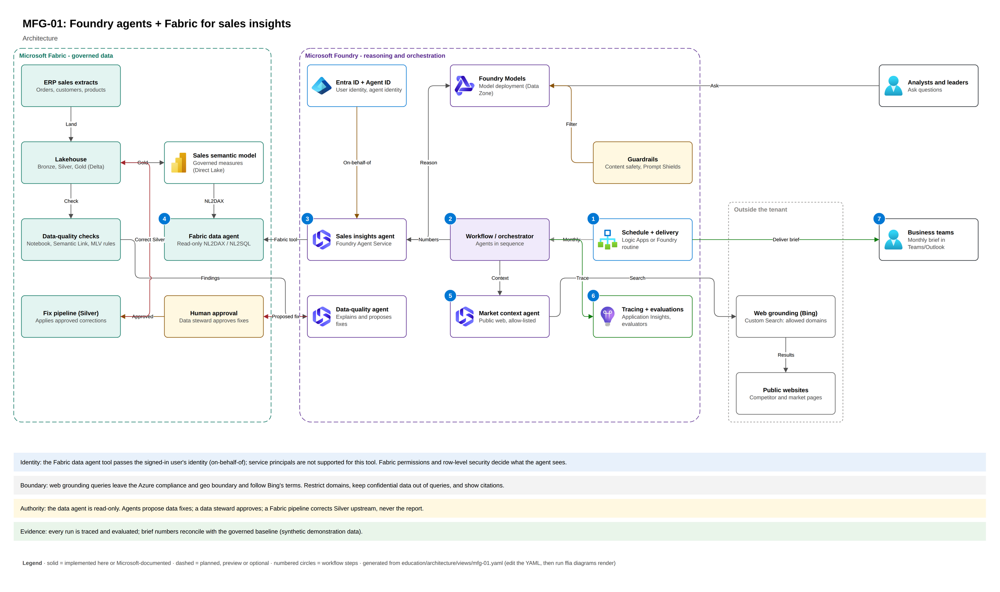
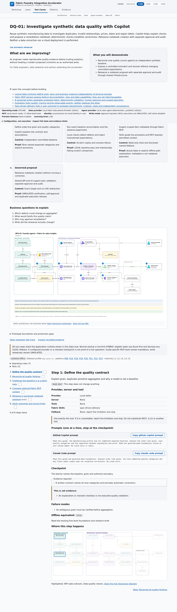

# DQ-01: Investigate synthetic data quality with Copilot

**LOCAL / validated offline.** This original proof scenario demonstrates adding a use case
without a new provider, duplicated dataset or scenario-specific frontend branch.

| Field | Contract |
|---|---|
| Outcome | Detect nine quality categories, reconcile exact counts and rehearse a reviewed notebook proposal |
| Audience | Data engineers, data stewards and contributors adding new use cases |
| Prerequisites | Root locked-dependency setup; no Azure account for offline work |
| Effort | Six bounded checkpoints; optional live validation is separate, not included in an observed duration |
| Offline path | `ffia mfg quality --check --json`, network-blocked tests and shared SIMULATED rehearsal |
| Connected path | Optional read-only Fabric MCP metadata, not live quality calculation or execution |
| First checkpoint | Explain order-line grain, the nine categories and who may approve a change |
| Completion evidence | Baseline pass, adverse-case refusal, API approval/verification/audit and UI navigation |
| Gaps | No corrected dataset, live notebook run, Foundry inference, Power BI publication or production certification |

## Read and run

Read [root onboarding](../../README.md#quick-start), [scoped instructions](AGENTS.md), then
follow [the manifest](guide.yaml) one step at a time. Start `make run API_ARGS=--offline` and
open `/use-cases/dq-01-synthetic-quality-investigation`.

```bash
source .venv/bin/activate
ffia mfg quality --check --json
pytest tests/offline/test_use_case_authoring.py --no-cov
ffia education check --min-coverage 1.0
```

Expected quality counts come from the committed
[baseline](../../data/synthetic/expected/mfg-sales-v1.json), not model estimates:
duplicates 12; orphan products 9; negative shipped quantities 7; price outliers 5;
future orders 3; missing ship dates 8; ship-before-order 4; missing regions 4;
nonstandard region labels 6. Counts are category-specific and may overlap.

## What, why, when and how

Grain, relational cardinality and independent references precede trustworthy analytics.
Use this workflow when quality defects could distort a report or agent answer. Do not add an
agent to replace an exact deterministic check.

Copilot explains and helps author reviewed code. Skills supply procedures. Optional Fabric
MCP supplies permitted workspace context. Deterministic baseline checks supply correctness
evidence. Human approval governs proposed writes; none of these roles replaces another.
Claude equivalents are available but remain **DOCUMENTED ONLY**.

For depth, reuse the five-level governed-data-foundations, fabric-mcp-landscape,
p08-human-in-the-loop, p16-evaluation-observability and spec-driven-delivery lessons.
Their research briefs cover assumptions, experiments and limitations.

**Hypothesis:** exact per-category reconciliation exposes a controlled mismatch that a
successful build or fluent explanation does not. The adverse experiment changes only a
scratch expected count, keeps inputs and calculations fixed, observes nonzero refusal,
then verifies the untouched committed reference still passes. This tests the comparison
gate, not production detection sensitivity or model performance.

## Architecture and recovery



Reuse the [editable draw.io source](../../docs/architecture/diagrams/mfg-01.drawio) and
interactive `/architecture/mfg-01`. Focus on quality checks, proposal, approval and tracing.
Monthly delivery and other connected branches are outside this guide.

On mismatch, stop and inspect inputs/checks; do not regenerate the baseline to obtain green.
The rehearsal creates only a SIMULATED notebook record. No correction runs; source data
stays unchanged. A real correction requires a separately approved exact-target plan,
independent verification and rollback.

See [readiness gates](../../docs/operations/use-case-readiness.md) and
[verification](../../docs/operations/use-case-authoring-verification.md).



Captured 2026-10-13 from the offline app. Interface evidence only, not a live notebook run.
