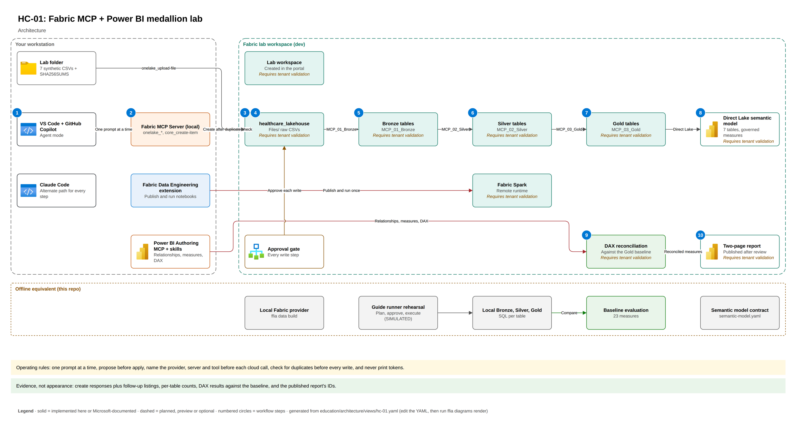

# Guide HC-01: Fabric MCP + Power BI medallion lab (healthcare, synthetic)

Learn how to use GitHub Copilot in VS Code with **Microsoft Fabric MCP** and reviewed skills.
The full build path covers Fabric Spark notebooks, a Direct Lake model, DAX checks and a
two-page report.

**`ffia-local` is a separate synthetic learning server.** A locally hosted Fabric MCP server
can still call live services. Claude Code prompts are available as instructions only.
All data and analytical metrics are synthetic. No clinical advice is provided.

The guide includes reviewed notebooks, an offline reference build and independent synthetic
baselines. Verify each connected step in your own environment; the guide is not certification
of a tenant deployment. Keep execution receipts and session progress in ignored local storage.

## Start this use case

| Question | Answer |
|---|---|
| Outcome | Learn how GitHub Copilot, reviewed Skills and exact MCP tools improve a governed Fabric engineering workflow |
| Audience | Data engineers and Power BI model/report authors |
| Prerequisites | [Root installation](../../README.md#quick-start); for connected work, the exact tools/settings/OS constraints in [guide.yaml](guide.yaml) |
| Effort | The linked engineering learning journey estimates 90 minutes; installation and the full 16-step live lab take additional environment-dependent time |
| Offline path | Launch `make run API_ARGS=--offline` from the repo root; open Use Cases → HC-01; build the local reference below |
| Connected path | Read [readiness](../../docs/operations/fabric-tenant-readiness.md), then step 01 tool setup and step 02's actual MCP call; every write needs approval |
| First checkpoint | Step `01-set-up-tools`: required tools are callable and seven CSVs match SHA256SUMS; configured manifests alone are not proof |
| Completion evidence | Follow each step's required evidence and reconcile with the baseline; local files/screenshots do not prove notebook execution or report publication |
| Production gaps | Full live lab certification, production identity/network/operations and rollback verification remain separate |

Read [scoped instructions](AGENTS.md), then use one prompt from [guide.yaml](guide.yaml).
Stop at the checkpoint and keep the required evidence. The offline path is validated.
Verify connected steps through the tools assigned by the guide. See
[dated verification](../../docs/operations/phase-verification.md).

## Architecture



[Editable draw.io source](../../docs/architecture/diagrams/hc-01.drawio) /
[step-by-step architecture explanation](../../docs/architecture/hc-01-architecture.md).
This is the intended workflow, not evidence that tenant writes ran. Claude Code remains
DOCUMENTED ONLY in the bake-off; its alternate prompts are available for each step.

## Build and reconcile the local data

| Asset | Where | Notes |
|---|---|---|
| Source data | Dataset profile `hc-lab-7file-v1` | Same counts and quirks as the guide baseline: 200 / 1,025 / 428 / 1,025 / 4,299 / 643 / 150 |
| Expected baseline | `data/synthetic/expected/hc-lab-7file-v1.json` | Row counts for all 24 tables, Silver diagnostics, reconciliation totals and every measure |
| Semantic model contract | `data/synthetic/semantic/hc-lab-7file-v1/semantic-model.yaml` | 7 tables, star relationships, measure contracts with reference DAX; Bed Occupancy excluded |
| Local reference build | `ffia data build --profile hc-lab-7file-v1` | Offline Bronze/Silver/Gold to compare against the live Fabric run |

Copy the data into a separate lab project folder, as the guide recommends:

```bash
ffia data export --profile hc-lab-7file-v1 --dest ~/hc-01-lab/data/raw
cd ~/hc-01-lab/data/raw && sha256sum -c SHA256SUMS
```

## Follow checkpoints and rehearse changes

| Asset | Where | Notes |
|---|---|---|
| Guide manifest | `guide.yaml` | 16 steps. Each one has GitHub Copilot and Claude Code prompts, a checkpoint, required evidence, an offline equivalent and, where relevant, "not evidence" warnings. Every write step requires approval. |
| Step lookup | `GET /api/v1/guides/hc-01-fabric-mcp-powerbi-medallion-lab/steps/{step_id}` or the `get_guide_step` tool on `ffia-local` | Read-only. LOCAL label. |
| Governed write rehearsal | `POST /api/v1/plans` → `/approvals` → `/fabric/change` with `destination: LOCAL` | SIMULATED. Rehearses the lakehouse, notebook, upload, model and report writes without a tenant. |
| Baseline check | `POST /api/v1/evaluations/run` or the `evaluate_against_baseline` tool | Compares the measures with `data/synthetic/expected/hc-lab-7file-v1.json` |

## Prepare the connected tools

Follow [notebook and Power BI tooling setup](../../docs/operations/notebook-powerbi-tooling.md)
before publication or model work. The Fabric Notebook MCP server supplies inspection/documentation;
`fabricPublishNotebook` is a separate VS Code tool and execution uses the remote kernel. Restart
Power BI read-only, authorize its EULA explicitly, and verify actual client tool exposure.

| Asset | Where | Notes |
|---|---|---|
| Guide-scoped agent files | `AGENTS.md`, `CLAUDE.md`, `.mcp.json` in this folder | `.mcp.json` is the rendered `hc01-lab` profile: the real Fabric MCP server with only the tools steps 02 to 05 name (writes approved per call), plus `ffia-local` as the labeled fallback. Each step in `guide.yaml` names its Fabric Skills (`skills`) and its fallback (`tool_path.fallback`). |
| VS Code MCP config | `ffia mcp render hc01-lab --client vscode --output <LAB_PATH>/.vscode/mcp.json` | Checked against the pinned Fabric MCP 1.4.0 tool catalog |
| Fabric and Power BI skills | `ffia skills install` | `skills-for-fabric` v0.3.18, SHA-256 verified, 4 curated skills; `az rest` needs approval |
| Reference notebooks | `fabric/workspace/MCP_01_Bronze.Notebook` … `MCP_03_Gold.Notebook` | Fabric Git format; 85/85 checks pass on local Spark 3.5.9 (LOCAL). Running in Fabric requires tenant validation |
| Tenant readiness | `ffia fabric readiness` | Read-only; see `docs/operations/fabric-tenant-readiness.md` |

Step 02 uses `core_search-catalog` and `onelake_list-items`: in a demo tenant with Fabric MCP 1.4.0,
`onelake_list-workspaces` returned an empty list while workspace-scoped calls worked.
